<!-- PROFILE-HERO:START -->
<a href="https://github.com/DejavuMoe#gh-light-mode-only">
<picture>
  <source media="(max-width: 600px)" srcset="assets/generated/hero-light-mobile.svg">
  
</picture>
</a>

<a href="https://github.com/DejavuMoe#gh-dark-mode-only">
<picture>
  <source media="(max-width: 600px)" srcset="assets/generated/hero-dark-mobile.svg">
  
</picture>
</a>
<!-- PROFILE-HERO:END -->

  <a href="https://blog.dejavu.moe">Blog ↗</a> &nbsp; / &nbsp;
  <a href="#01--selected-work">Projects ↓</a> &nbsp; / &nbsp;
  <a href="https://pgp.dejavu.moe">PGP ↗</a>

### 👋 Hi there

**I am Dejavu Moe, a curious explorer.**

My **personal website**: https://dejavu.moe

 

## 01 / Selected work

Things I build, maintain, and use. Small tools, on my own terms.

<!-- PROJECTS:START -->
<a href="https://github.com/DejavuMoe/edgeTTS#gh-light-mode-only">
<picture>
  <source media="(max-width: 600px)" srcset="assets/generated/project-01-light-mobile.svg">
  
</picture>
</a>

<a href="https://github.com/DejavuMoe/edgeTTS#gh-dark-mode-only">
<picture>
  <source media="(max-width: 600px)" srcset="assets/generated/project-01-dark-mobile.svg">
  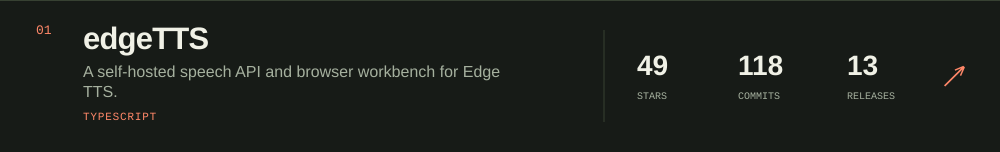
</picture>
</a>

<a href="https://github.com/DejavuMoe/Ecoku#gh-light-mode-only">
<picture>
  <source media="(max-width: 600px)" srcset="assets/generated/project-02-light-mobile.svg">
  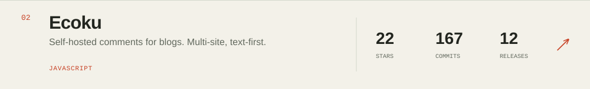
</picture>
</a>

<a href="https://github.com/DejavuMoe/Ecoku#gh-dark-mode-only">
<picture>
  <source media="(max-width: 600px)" srcset="assets/generated/project-02-dark-mobile.svg">
  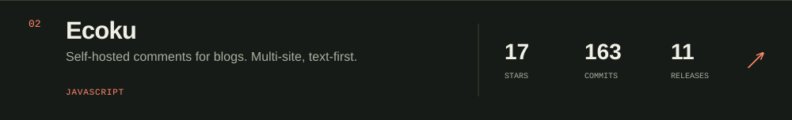
</picture>
</a>

<a href="https://github.com/DejavuMoe/Smoji#gh-light-mode-only">
<picture>
  <source media="(max-width: 600px)" srcset="assets/generated/project-03-light-mobile.svg">
  
</picture>
</a>

<a href="https://github.com/DejavuMoe/Smoji#gh-dark-mode-only">
<picture>
  <source media="(max-width: 600px)" srcset="assets/generated/project-03-dark-mobile.svg">
  
</picture>
</a>

<a href="https://github.com/DejavuMoe/sani#gh-light-mode-only">
<picture>
  <source media="(max-width: 600px)" srcset="assets/generated/project-04-light-mobile.svg">
  
</picture>
</a>

<a href="https://github.com/DejavuMoe/sani#gh-dark-mode-only">
<picture>
  <source media="(max-width: 600px)" srcset="assets/generated/project-04-dark-mobile.svg">
  
</picture>
</a>

<a href="https://github.com/DejavuMoe/PicForge#gh-light-mode-only">
<picture>
  <source media="(max-width: 600px)" srcset="assets/generated/project-05-light-mobile.svg">
  
</picture>
</a>

<a href="https://github.com/DejavuMoe/PicForge#gh-dark-mode-only">
<picture>
  <source media="(max-width: 600px)" srcset="assets/generated/project-05-dark-mobile.svg">
  
</picture>
</a>

<a href="https://github.com/DejavuMoe/romi#gh-light-mode-only">
<picture>
  <source media="(max-width: 600px)" srcset="assets/generated/project-06-light-mobile.svg">
  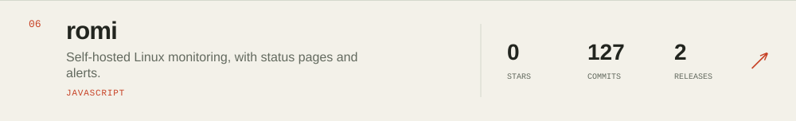
</picture>
</a>

<a href="https://github.com/DejavuMoe/romi#gh-dark-mode-only">
<picture>
  <source media="(max-width: 600px)" srcset="assets/generated/project-06-dark-mobile.svg">
  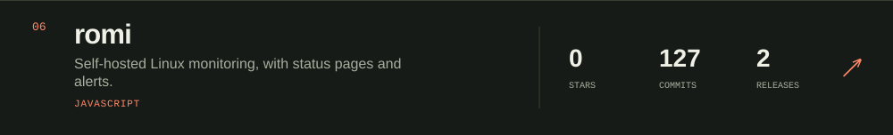
</picture>
</a>

Snapshot 2026-10-12 UTC · 17 indexed repositories · 239 stars across this index

Selection notes &amp; full project index

Only my public, non-fork, non-archived repositories with commit history are eligible; this profile repository is excluded. The 6 entries above balance stars (35%), default-branch commits (45%) and published releases (20%), using logarithmic scaling. Commits include **all authors**, not just me. Releases include prereleases, exclude drafts, and are not Git tags.

| Project | Stars | Commits | Releases |
| :--- | ---: | ---: | ---: |
| [edgeTTS](https://github.com/DejavuMoe/edgeTTS) | 46 | 118 | 13 |
| [Ecoku](https://github.com/DejavuMoe/Ecoku) | 14 | 162 | 11 |
| [Smoji](https://github.com/DejavuMoe/Smoji) | 115 | 53 | 0 |
| [sani](https://github.com/DejavuMoe/sani) | 3 | 78 | 17 |
| [PicForge](https://github.com/DejavuMoe/PicForge) | 24 | 63 | 0 |
| [romi](https://github.com/DejavuMoe/romi) | 0 | 127 | 2 |
| [webfonts](https://github.com/DejavuMoe/webfonts) | 5 | 20 | 5 |
| [hugo\-start](https://github.com/DejavuMoe/hugo-start) | 4 | 17 | 0 |
| [selfhosted](https://github.com/DejavuMoe/selfhosted) | 0 | 47 | 0 |
| [deepseek\_wale\_girl](https://github.com/DejavuMoe/deepseek_wale_girl) | 18 | 1 | 0 |
| [prototype\-first\-ui](https://github.com/DejavuMoe/prototype-first-ui) | 8 | 1 | 1 |
| [STranslate\.Plugin\.Tts\.edgeTTS](https://github.com/DejavuMoe/STranslate.Plugin.Tts.edgeTTS) | 1 | 4 | 1 |
| [paddle\-vanity\-pgp](https://github.com/DejavuMoe/paddle-vanity-pgp) | 0 | 9 | 0 |
| [omarchy\-singbox\-plugin](https://github.com/DejavuMoe/omarchy-singbox-plugin) | 1 | 2 | 1 |
| [omarchy\-ai\-usage\-plugin](https://github.com/DejavuMoe/omarchy-ai-usage-plugin) | 0 | 4 | 1 |
| [Gxif\-Converter](https://github.com/DejavuMoe/Gxif-Converter) | 0 | 2 | 0 |
| [via\.moe](https://github.com/DejavuMoe/via.moe) | 0 | 1 | 0 |

[How this profile updates](docs/profile.md) · [Public data snapshot](data/profile.json)

<!-- PROJECTS:END -->

 

## 02 / Recent Posts

Notes on self-hosting, things I learn, and life in between. [All writing ↗](https://blog.dejavu.moe)

<!-- BLOG-POST-LIST:START -->
- 2026.10.08 &nbsp; [寒露与幻梦](<https://blog.dejavu.moe/posts/cold-dew/>)
- 2026.10.07 &nbsp; [介绍 Ecoku 评论系统](<https://blog.dejavu.moe/posts/ecoku-comment-system/>)
- 2026.10.04 &nbsp; [Windows 搭建 WSL2 AI 开发环境](<https://blog.dejavu.moe/posts/windows-wsl2-ai-dev-environment/>)
- 2026.09.27 &nbsp; [edgeTTS 自托管语音合成 API](<https://blog.dejavu.moe/posts/edgetts/>)
- 2026.08.24 &nbsp; [第一次起飞](<https://blog.dejavu.moe/posts/first-time-flying/>)
- 2026.08.19 &nbsp; [Hugo 实现页面加密](<https://blog.dejavu.moe/posts/hugo-protected-leaf-bundle-encryption/>)
- 2026.08.04 &nbsp; [Riven Cloud 新加坡 Premium VPS 测评](<https://blog.dejavu.moe/posts/review-of-rivencloud-premium-vps/>)
- 2026.07.06 &nbsp; [PicForge 本地图片工具箱](<https://blog.dejavu.moe/posts/picforge-webapp/>)
<!-- BLOG-POST-LIST:END -->

 

## 03 / Identity

My **PGP Key**: [`ed25519/DF96 8883 EA3B DBCC 9326 D260 1A66 6666 6666 6666`](https://pgp.dejavu.moe) `(master key)`

- `ed25519/0x8422222222222222` `(signing subkey)`
- `cv25519/0x4444444444444444` `(encryption subkey)`
- `ed25519/0x3C1CCCCCCCCCCCCC` `(authentication subkey)`

---

just for fun. &nbsp; / &nbsp; Project index refreshed daily · Writing refreshed every 6 hours.
