<h3 align="center">Hi, I'm Dejavu Moe 👋</h3>

A curious explorer who builds small, self-hosted tools.

  <a href="https://dejavu.moe"><b>Personal website</b></a> &nbsp;·&nbsp;
  <a href="https://blog.dejavu.moe"><b>Blog</b></a> &nbsp;·&nbsp;
  <a href="https://x.com/MoeDejavu"><b>X</b></a> &nbsp;·&nbsp;
  <a href="https://pgp.dejavu.moe"><b>PGP</b></a> &nbsp;·&nbsp;
  <a href="https://blog.dejavu.moe/index.xml"><b>RSS</b></a>

## 📌 &nbsp;Projects

<!-- PINS:START -->

<a href="https://github.com/DejavuMoe/Pail#gh-light-mode-only"><picture><source media="(max-width: 600px)" srcset="assets/generated/pin-pail-light-mobile.svg">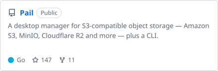</picture></a>
<a href="https://github.com/DejavuMoe/Pail#gh-dark-mode-only"><picture><source media="(max-width: 600px)" srcset="assets/generated/pin-pail-dark-mobile.svg">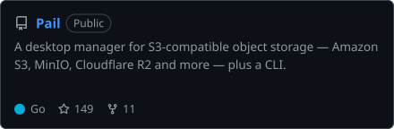</picture></a>
<a href="https://github.com/DejavuMoe/Smoji#gh-light-mode-only"><picture><source media="(max-width: 600px)" srcset="assets/generated/pin-smoji-light-mobile.svg">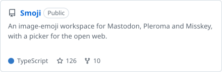</picture></a>
<a href="https://github.com/DejavuMoe/Smoji#gh-dark-mode-only"><picture><source media="(max-width: 600px)" srcset="assets/generated/pin-smoji-dark-mobile.svg">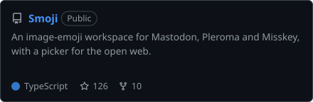</picture></a>

<a href="https://github.com/DejavuMoe/edgeTTS#gh-light-mode-only"><picture><source media="(max-width: 600px)" srcset="assets/generated/pin-edgetts-light-mobile.svg">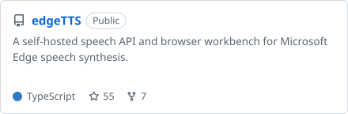</picture></a>
<a href="https://github.com/DejavuMoe/edgeTTS#gh-dark-mode-only"><picture><source media="(max-width: 600px)" srcset="assets/generated/pin-edgetts-dark-mobile.svg">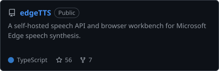</picture></a>
<a href="https://github.com/DejavuMoe/Ecoku#gh-light-mode-only"><picture><source media="(max-width: 600px)" srcset="assets/generated/pin-ecoku-light-mobile.svg">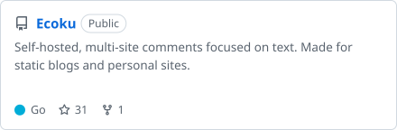</picture></a>
<a href="https://github.com/DejavuMoe/Ecoku#gh-dark-mode-only"><picture><source media="(max-width: 600px)" srcset="assets/generated/pin-ecoku-dark-mobile.svg">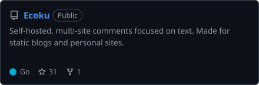</picture></a>

<a href="https://github.com/DejavuMoe/PicForge#gh-light-mode-only"><picture><source media="(max-width: 600px)" srcset="assets/generated/pin-picforge-light-mobile.svg">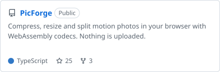</picture></a>
<a href="https://github.com/DejavuMoe/PicForge#gh-dark-mode-only"><picture><source media="(max-width: 600px)" srcset="assets/generated/pin-picforge-dark-mobile.svg">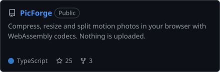</picture></a>
<a href="https://github.com/DejavuMoe/sani#gh-light-mode-only"><picture><source media="(max-width: 600px)" srcset="assets/generated/pin-sani-light-mobile.svg">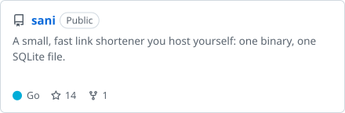</picture></a>
<a href="https://github.com/DejavuMoe/sani#gh-dark-mode-only"><picture><source media="(max-width: 600px)" srcset="assets/generated/pin-sani-dark-mobile.svg">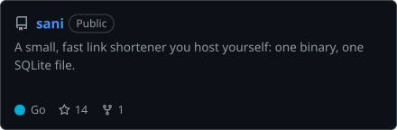</picture></a>

<a href="https://github.com/DejavuMoe/romi#gh-light-mode-only"><picture><source media="(max-width: 600px)" srcset="assets/generated/pin-romi-light-mobile.svg">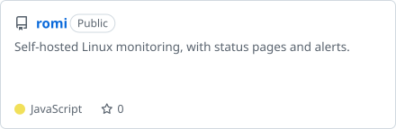</picture></a>
<a href="https://github.com/DejavuMoe/romi#gh-dark-mode-only"><picture><source media="(max-width: 600px)" srcset="assets/generated/pin-romi-dark-mobile.svg">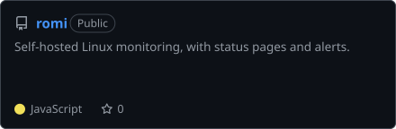</picture></a>
<a href="https://github.com/DejavuMoe/webfont-slice#gh-light-mode-only"><picture><source media="(max-width: 600px)" srcset="assets/generated/pin-webfont-slice-light-mobile.svg">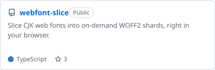</picture></a>
<a href="https://github.com/DejavuMoe/webfont-slice#gh-dark-mode-only"><picture><source media="(max-width: 600px)" srcset="assets/generated/pin-webfont-slice-dark-mobile.svg">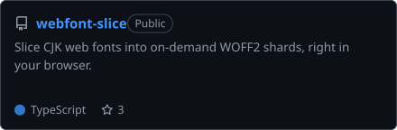</picture></a>

<!-- PINS:END -->

## 📰 &nbsp;Writing

Notes on self-hosting, things I learn, and life in between. [All writing ↗](https://blog.dejavu.moe)

<!-- BLOG-POST-LIST:START -->
- `2026.10.08` &nbsp; **[寒露与幻梦](<https://blog.dejavu.moe/posts/cold-dew/>)** 我的青春症候群结束了。
- `2026.10.07` &nbsp; **[介绍 Ecoku 评论系统](<https://blog.dejavu.moe/posts/ecoku-comment-system/>)** 开源本博客正在使用的自托管评论系统 Ecoku——轻量、纯粹、支持多站点，更适合个人网站。
- `2026.10.04` &nbsp; **[Windows 搭建 WSL2 AI 开发环境](<https://blog.dejavu.moe/posts/windows-wsl2-ai-dev-environment/>)** 介绍我在 Windows 上使用 WSL2 打造 AI 开发环境的一些思路，源码和 AI Agent 留在 Windows，WSL2 只当编译测试沙盒，用调度脚本和约束规则串联工作流
- `2026.09.27` &nbsp; **[edgeTTS 自托管语音合成 API](<https://blog.dejavu.moe/posts/edgetts/>)** 基于微软 Edge TTS 在线语音服务的自托管 API 和 Web 工作台，支持 MP3 流式合成与长文本。
- `2026.08.24` &nbsp; **[第一次起飞](<https://blog.dejavu.moe/posts/first-time-flying/>)** 人生的第一次飞行，第一次出差，以及一些小插曲。
- `2026.08.19` &nbsp; **[Hugo 实现页面加密](<https://blog.dejavu.moe/posts/hugo-protected-leaf-bundle-encryption/>)** 使用密码保护 Hugo 页面内容，在构建静态网站时对指定的 Leaf Bundle 进行加密，使正文、图片与附件一同密封，并在访问时直接在浏览器中通过密码解密。
- `2026.08.04` &nbsp; **[Riven Cloud 新加坡 Premium VPS 测评](<https://blog.dejavu.moe/posts/review-of-rivencloud-premium-vps/>)** Riven Cloud 新加坡 Premium VPS 测评记录。
- `2026.07.06` &nbsp; **[PicForge 本地图片工具箱](<https://blog.dejavu.moe/posts/picforge-webapp/>)** 在浏览器里压缩图片、处理实况照片，文件不上传。
<!-- BLOG-POST-LIST:END -->

## 🔑 &nbsp;Identity

My **PGP Key**: [`ed25519/DF96 8883 EA3B DBCC 9326 D260 1A66 6666 6666 6666`](https://pgp.dejavu.moe) `(master key)`

- `ed25519/0x8422222222222222` `(signing subkey)`
- `cv25519/0x4444444444444444` `(encryption subkey)`
- `ed25519/0x3C1CCCCCCCCCCCCC` `(authentication subkey)`

 

Cards and posts are refreshed by <a href=".github/workflows/profile.yml">GitHub Actions</a> · <a href="docs/profile.md">how it works</a>

