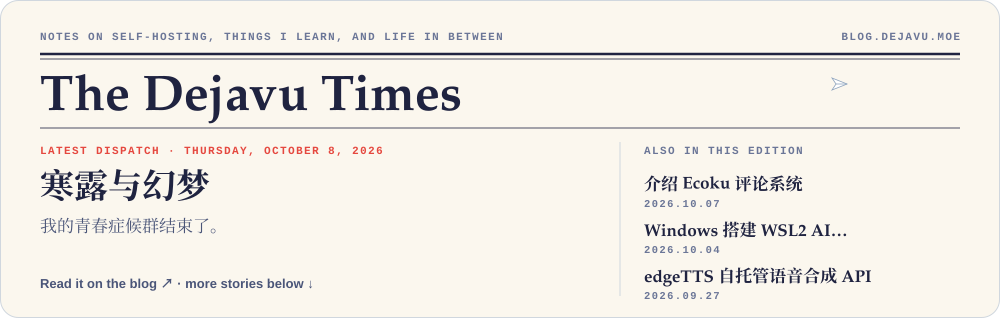
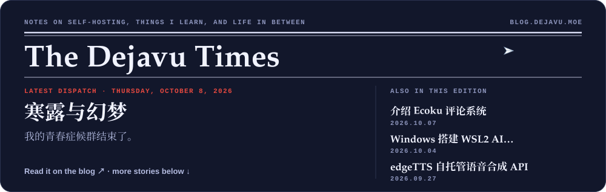
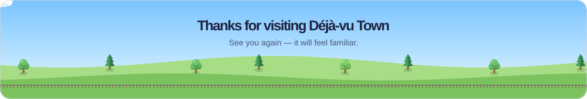
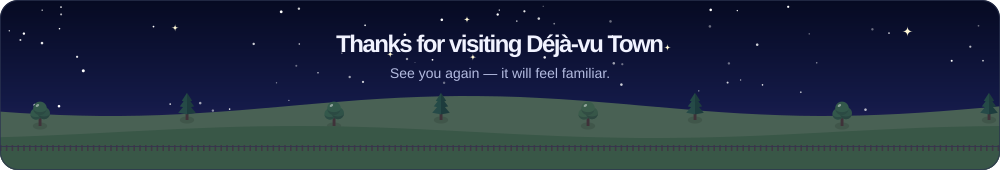

<!-- PROFILE-HERO:START -->
<a href="https://github.com/DejavuMoe#gh-light-mode-only">
<picture>
  <source media="(max-width: 600px)" srcset="assets/generated/hero-light-mobile.svg">
  
</picture>
</a>

<a href="https://github.com/DejavuMoe#gh-dark-mode-only">
<picture>
  <source media="(max-width: 600px)" srcset="assets/generated/hero-dark-mobile.svg">
  
</picture>
</a>
<!-- PROFILE-HERO:END -->

  <a href="https://dejavu.moe"><b>Personal website</b></a> &nbsp;·&nbsp;
  <a href="https://blog.dejavu.moe"><b>Blog</b></a> &nbsp;·&nbsp;
  <a href="https://x.com/MoeDejavu"><b>X</b></a> &nbsp;·&nbsp;
  <a href="https://pgp.dejavu.moe"><b>PGP</b></a> &nbsp;·&nbsp;
  <a href="https://blog.dejavu.moe/index.xml"><b>RSS</b></a>

 

## 🏘️ &nbsp;The town

Every building on the island is one of these projects. Tap a card to open its repository.

<!-- PROJECTS:START -->
<a href="https://github.com/DejavuMoe/Ecoku#gh-light-mode-only">
<picture>
  <source media="(max-width: 600px)" srcset="assets/generated/project-01-light-mobile.svg">
  
</picture>
</a>

<a href="https://github.com/DejavuMoe/Ecoku#gh-dark-mode-only">
<picture>
  <source media="(max-width: 600px)" srcset="assets/generated/project-01-dark-mobile.svg">
  
</picture>
</a>

<a href="https://github.com/DejavuMoe/edgeTTS#gh-light-mode-only">
<picture>
  <source media="(max-width: 600px)" srcset="assets/generated/project-02-light-mobile.svg">
  
</picture>
</a>

<a href="https://github.com/DejavuMoe/edgeTTS#gh-dark-mode-only">
<picture>
  <source media="(max-width: 600px)" srcset="assets/generated/project-02-dark-mobile.svg">
  
</picture>
</a>

<a href="https://github.com/DejavuMoe/Smoji#gh-light-mode-only">
<picture>
  <source media="(max-width: 600px)" srcset="assets/generated/project-03-light-mobile.svg">
  
</picture>
</a>

<a href="https://github.com/DejavuMoe/Smoji#gh-dark-mode-only">
<picture>
  <source media="(max-width: 600px)" srcset="assets/generated/project-03-dark-mobile.svg">
  
</picture>
</a>

<a href="https://github.com/DejavuMoe/sani#gh-light-mode-only">
<picture>
  <source media="(max-width: 600px)" srcset="assets/generated/project-04-light-mobile.svg">
  
</picture>
</a>

<a href="https://github.com/DejavuMoe/sani#gh-dark-mode-only">
<picture>
  <source media="(max-width: 600px)" srcset="assets/generated/project-04-dark-mobile.svg">
  
</picture>
</a>

<a href="https://github.com/DejavuMoe/PicForge#gh-light-mode-only">
<picture>
  <source media="(max-width: 600px)" srcset="assets/generated/project-05-light-mobile.svg">
  
</picture>
</a>

<a href="https://github.com/DejavuMoe/PicForge#gh-dark-mode-only">
<picture>
  <source media="(max-width: 600px)" srcset="assets/generated/project-05-dark-mobile.svg">
  
</picture>
</a>

<a href="https://github.com/DejavuMoe/romi#gh-light-mode-only">
<picture>
  <source media="(max-width: 600px)" srcset="assets/generated/project-06-light-mobile.svg">
  
</picture>
</a>

<a href="https://github.com/DejavuMoe/romi#gh-dark-mode-only">
<picture>
  <source media="(max-width: 600px)" srcset="assets/generated/project-06-dark-mobile.svg">
  
</picture>
</a>

<a href="https://github.com/DejavuMoe/webfont-slice#gh-light-mode-only">
<picture>
  <source media="(max-width: 600px)" srcset="assets/generated/project-07-light-mobile.svg">
  
</picture>
</a>

<a href="https://github.com/DejavuMoe/webfont-slice#gh-dark-mode-only">
<picture>
  <source media="(max-width: 600px)" srcset="assets/generated/project-07-dark-mobile.svg">
  
</picture>
</a>

<a href="https://github.com/DejavuMoe/Pail#gh-light-mode-only">
<picture>
  <source media="(max-width: 600px)" srcset="assets/generated/project-08-light-mobile.svg">
  
</picture>
</a>

<a href="https://github.com/DejavuMoe/Pail#gh-dark-mode-only">
<picture>
  <source media="(max-width: 600px)" srcset="assets/generated/project-08-dark-mobile.svg">
  
</picture>
</a>

<b>Try them live&nbsp;→</b>&nbsp; <a href="https://ecoku.zsh.moe">Ecoku</a> &nbsp;·&nbsp; <a href="https://tts-api.via.moe">edgeTTS</a> &nbsp;·&nbsp; <a href="https://smoji.zsh.moe">Smoji</a> &nbsp;·&nbsp; <a href="https://sani.zsh.moe">sani</a> &nbsp;·&nbsp; <a href="https://picforge.de">PicForge</a> &nbsp;·&nbsp; <a href="https://webfont.zsh.moe">webfont-slice</a> &nbsp;·&nbsp; <a href="https://pail.download">Pail</a>

Snapshot 2026-10-21 UTC · 20 indexed repositories · 275 stars across this index

How the town is built &amp; the full project index

Only my public, non-fork, non-archived repositories with commit history are eligible; this profile repository is excluded. The 8 buildings are a curated list, topped up by a score that balances stars (35%), default-branch commits (45%) and published releases (20%) on a logarithmic scale. A building's height follows its commits relative to the others; a roof flag means at least one published release. Commits include **all authors**, not just me. Releases include prereleases, exclude drafts, and are not Git tags.

| Project | In town | Stars | Commits | Releases |
| :--- | :---: | ---: | ---: | ---: |
| [edgeTTS](https://github.com/DejavuMoe/edgeTTS) | 🏠 | 49 | 118 | 13 |
| [Ecoku](https://github.com/DejavuMoe/Ecoku) | 🏠 | 25 | 183 | 14 |
| [Smoji](https://github.com/DejavuMoe/Smoji) | 🏠 | 118 | 54 | 0 |
| [sani](https://github.com/DejavuMoe/sani) | 🏠 | 7 | 83 | 18 |
| [PicForge](https://github.com/DejavuMoe/PicForge) | 🏠 | 25 | 63 | 0 |
| [Pail](https://github.com/DejavuMoe/Pail) | 🏠 | 11 | 41 | 2 |
| [romi](https://github.com/DejavuMoe/romi) | 🏠 | 0 | 127 | 2 |
| [webfonts](https://github.com/DejavuMoe/webfonts) |  | 5 | 20 | 5 |
| [hugo\-start](https://github.com/DejavuMoe/hugo-start) |  | 4 | 17 | 0 |
| [selfhosted](https://github.com/DejavuMoe/selfhosted) |  | 0 | 47 | 0 |
| [webfont\-slice](https://github.com/DejavuMoe/webfont-slice) | 🏠 | 2 | 13 | 0 |
| [deepseek\_wale\_girl](https://github.com/DejavuMoe/deepseek_wale_girl) |  | 19 | 1 | 0 |
| [prototype\-first\-ui](https://github.com/DejavuMoe/prototype-first-ui) |  | 8 | 1 | 1 |
| [TAdmin](https://github.com/DejavuMoe/TAdmin) |  | 0 | 9 | 1 |
| [STranslate\.Plugin\.Tts\.edgeTTS](https://github.com/DejavuMoe/STranslate.Plugin.Tts.edgeTTS) |  | 1 | 4 | 1 |
| [paddle\-vanity\-pgp](https://github.com/DejavuMoe/paddle-vanity-pgp) |  | 0 | 9 | 0 |
| [omarchy\-singbox\-plugin](https://github.com/DejavuMoe/omarchy-singbox-plugin) |  | 1 | 2 | 1 |
| [omarchy\-ai\-usage\-plugin](https://github.com/DejavuMoe/omarchy-ai-usage-plugin) |  | 0 | 4 | 1 |
| [Gxif\-Converter](https://github.com/DejavuMoe/Gxif-Converter) |  | 0 | 2 | 0 |
| [via\.moe](https://github.com/DejavuMoe/via.moe) |  | 0 | 1 | 0 |

[How this profile updates](docs/profile.md) · [Public data snapshot](data/profile.json)

<!-- PROJECTS:END -->

 

## 📰 &nbsp;Writing

Notes on self-hosting, things I learn, and life in between. [All writing ↗](https://blog.dejavu.moe)

<!-- BLOG-POST-LIST:START -->
<a href="https://blog.dejavu.moe/posts/cold-dew/#gh-light-mode-only">
<picture>
  <source media="(max-width: 600px)" srcset="assets/generated/writing-light-mobile.svg">
  
</picture>
</a>

<a href="https://blog.dejavu.moe/posts/cold-dew/#gh-dark-mode-only">
<picture>
  <source media="(max-width: 600px)" srcset="assets/generated/writing-dark-mobile.svg">
  
</picture>
</a>

- `2026.10.08` &nbsp; **[寒露与幻梦](<https://blog.dejavu.moe/posts/cold-dew/>)** 我的青春症候群结束了。
- `2026.10.07` &nbsp; **[介绍 Ecoku 评论系统](<https://blog.dejavu.moe/posts/ecoku-comment-system/>)** 开源本博客正在使用的自托管评论系统 Ecoku——轻量、纯粹、支持多站点，更适合个人网站。
- `2026.10.04` &nbsp; **[Windows 搭建 WSL2 AI 开发环境](<https://blog.dejavu.moe/posts/windows-wsl2-ai-dev-environment/>)** 介绍我在 Windows 上使用 WSL2 打造 AI 开发环境的一些思路，源码和 AI Agent 留在 Windows，WSL2 只当编译测试沙盒，用调度脚本和约束规则串联工作流
- `2026.09.27` &nbsp; **[edgeTTS 自托管语音合成 API](<https://blog.dejavu.moe/posts/edgetts/>)** 基于微软 Edge TTS 在线语音服务的自托管 API 和 Web 工作台，支持 MP3 流式合成与长文本。
- `2026.08.24` &nbsp; **[第一次起飞](<https://blog.dejavu.moe/posts/first-time-flying/>)** 第一次坐飞机，去广州出差。去程穿过了云层，回程把钱包落在了网约车上。
- `2026.08.19` &nbsp; **[Hugo 实现页面加密](<https://blog.dejavu.moe/posts/hugo-protected-leaf-bundle-encryption/>)** 使用密码保护 Hugo 页面内容，在构建静态网站时对指定的 Leaf Bundle 进行加密，使正文、图片与附件一同密封，并在访问时直接在浏览器中通过密码解密。
- `2026.08.04` &nbsp; **[Riven Cloud 新加坡 Premium VPS 测评](<https://blog.dejavu.moe/posts/review-of-rivencloud-premium-vps/>)** Riven Cloud 新加坡 Premium VPS 测评记录。
- `2026.07.06` &nbsp; **[PicForge 本地图片工具箱](<https://blog.dejavu.moe/posts/picforge-webapp/>)** 在浏览器里压缩图片、处理实况照片，文件不上传。
<!-- BLOG-POST-LIST:END -->

 

## 🔑 &nbsp;Identity

My **PGP Key**: [`ed25519/DF96 8883 EA3B DBCC 9326 D260 1A66 6666 6666 6666`](https://pgp.dejavu.moe) `(master key)`

- `ed25519/0x8422222222222222` `(signing subkey)`
- `cv25519/0x4444444444444444` `(encryption subkey)`
- `ed25519/0x3C1CCCCCCCCCCCCC` `(authentication subkey)`

 

<!-- FOOTER:START -->
<a href="https://github.com/DejavuMoe#gh-light-mode-only">
<picture>
  <source media="(max-width: 600px)" srcset="assets/generated/footer-light-mobile.svg">
  
</picture>
</a>

<a href="https://github.com/DejavuMoe#gh-dark-mode-only">
<picture>
  <source media="(max-width: 600px)" srcset="assets/generated/footer-dark-mobile.svg">
  
</picture>
</a>
<!-- FOOTER:END -->

just for fun. &nbsp;·&nbsp; The town is rebuilt daily and the newspaper every six hours by <a href=".github/workflows/profile.yml">GitHub Actions</a> · <a href="docs/profile.md">how it works</a>

